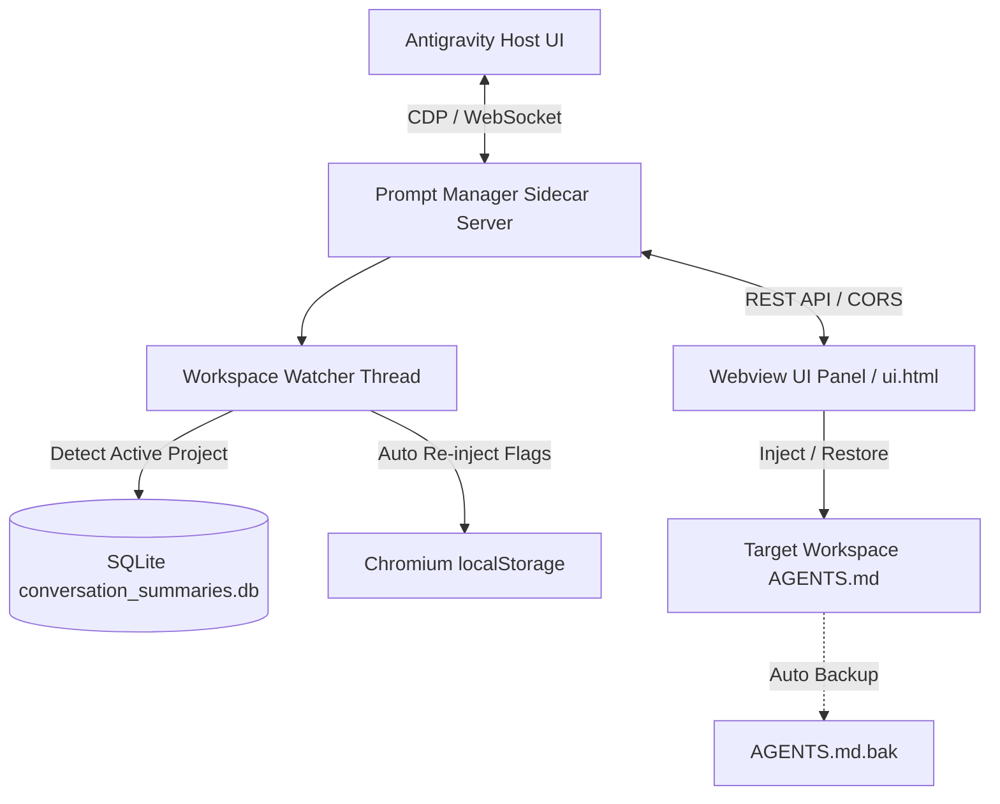

# Antigravity Prompt & Rule Manager (提示词与工作区规则管理器)

<p align="center">
  
  
  
  
  
</p>

<p align="center">
  <b>English</b> | <a href="#简体中文"><b>简体中文</b></a>
</p>

---

<a name="english"></a>
## 🌐 English

### Introduction
**Antigravity Prompt & Rule Manager** is a native Sidecar UI plugin designed for **Google Antigravity**. It allows developers to dynamically manage, compose, and inject workspace-specific `AGENTS.md` rules, switch prompt building blocks (Personas, Tech Stacks, Delivery Standards), customize presets with a visual editor, and automatically protect Antigravity's experimental developer flags across restarts.

### 🌟 Key Features

1. **Workspace-Aware Automatic Matching & Injection**
   - Automatically detects the active workspace of the current session.
   - Binds and injects workspace-tailored `AGENTS.md` rules automatically upon switching folders.
2. **Manual Custom Mode (Priority Retention)**
   - When switched to Custom Mode, the text written in the editor is prioritized and locked.
   - Prevents accidental overwrites or resets when navigating between presets or changing workspaces.
   - Supports cursor-accurate snippet insertion (`➕ Insert`) directly into custom text.
3. **Full Visual Preset & Snippet Editor**
   - **Preset Editor**: Customize preset names, descriptions, and toggle included snippets.
   - **Snippet Markdown Editor**: Edit the exact underlying Markdown text of any prompt snippet directly in the UI.
   - **Safe Rollback**: Revert individual snippets/presets or reset all to factory defaults at any time.
4. **Developer Features Auto-Guardian**
   - Solves the ephemeral port issue where Antigravity's Go Language Server rebinds ports on restart, causing Chromium origin `localStorage` feature flags to drop.
   - Automatically detects active ports via CDP and re-injects 30+ developer power flags (Conversation Forking, Developer Settings Panel, Turn-by-Turn Timeline Navigator, Inline Selection Quoting, Model Battle Arena, Split View, and Autonomous Mode).
5. **Zero-Loss Safety Backups**
   - Automatically creates an `AGENTS.md.bak` file before applying new rules, with one-click restoration.

---

### 🏗️ Architecture



---

### 📦 Installation

Clone or copy this repository into your Antigravity plugins directory:

```bash
# Windows
git clone https://github.com/KKKomeijiSatori/Antigravity-Prompt-Manager.git "%USERPROFILE%\.gemini\config\plugins\antigravity-prompt-manager"

# macOS / Linux
git clone https://github.com/KKKomeijiSatori/Antigravity-Prompt-Manager.git "$HOME/.gemini/config/plugins/antigravity-prompt-manager"
```

After cloning, restart Google Antigravity. The plugin will be automatically discovered, and its sidecar service will start with the application.

---

### 🚀 Usage

1. Open the plugin panel directly in Antigravity chat by clicking:
   ```markdown
   [Prompt Manager](sidecar://antigravity-prompt-manager/prompt_manager/ui.html)
   ```
   Or select **Prompt & Rule Manager** in the top-right Auxiliary Pane dropdown menu.
2. **Apply Presets**: Click any preset pill (e.g., *Standard Full-Stack*, *Architecture & Engineering*, *Concise Mode*, or *Production Security*).
3. **Customize Snippets**: Toggle modular snippets from *Personas*, *Tech Stack*, or *Delivery Standards*.
4. **Manual Custom Mode**: Click **`📌 Custom Mode`** to freely edit the Markdown content. Click **`📌 Save & Inject (Custom Priority)`** to persist your custom rules.
5. **Manage Presets & Snippets**: Click **`✏️ Manage Presets & Snippets`** to create new presets, add custom snippets, or edit prompt texts with the in-place editor.

---

<a name="简体中文"></a>
## 🇨🇳 简体中文

### 项目简介
**Antigravity 提示词与工作区规则管理器** 是专为 **Google Antigravity** 打造的原生内置 Sidecar UI 插件。支持按工作区动态匹配并注入 `AGENTS.md` 规则、积木式自由拼装提示词（角色设定、技术栈、交付规范）、可视化增删与深度编辑预设正文，并内置开发者特性防掉落常驻守护引擎。

### 🌟 核心特性

1. **随工作区自动匹配与静默注入**
   - 自动检测当前活跃会话所在工程工作区目录。
   - 切换不同项目时，自动匹配并加载该工作区绑定的专属 `AGENTS.md` 规则。
2. **手动自定义模式（优先保留）**
   - 激活自定义模式后，编辑器内手工撰写的规则拥有优先权，受到持久化锁定保护。
   - 切换方案或工程时不会被预设规则重置或意外覆盖。
   - 支持在手写正文中精细追加特定积木片段（`➕ 插入`）。
3. **预设方案与积木可视化深度管理**
   - **方案编辑器**：自由修改方案名称、描述，以及复选包含的积木片段。
   - **积木正文编辑器**：直接在界面弹窗内修改任意积木的 Markdown 完整提示词正文。
   - **安全出厂重置**：支持单独还原修改过的积木/预设，或一键重置为官方初始状态。
4. **开发者特性防掉落常驻守护 (DevFlags Guardian)**
   - 彻底解决 Antigravity 语言服务器（Go）每次重启随机分配端口导致的 Chromium 同源沙箱 `localStorage` 特性开关掉落问题。
   - 自动通过 CDP 协议侦测宿主端口，维持 30+ 项隐藏开发特性的常驻开启（包括对话派生分支 Fork、开发者设置面板、轮次时间线导航轨、划词快速引用、多模型对战评测、分屏视图与自治执行模式等）。
5. **安全备份机制**
   - 每次规则注入前自动生成 `AGENTS.md.bak` 备份文件，支持一键安全还原。

---

### 📦 安装方式

将本项目克隆或复制到 Antigravity 插件目录即可：

```bash
# Windows
git clone https://github.com/KKKomeijiSatori/Antigravity-Prompt-Manager.git "%USERPROFILE%\.gemini\config\plugins\antigravity-prompt-manager"

# macOS / Linux
git clone https://github.com/KKKomeijiSatori/Antigravity-Prompt-Manager.git "$HOME/.gemini/config/plugins/antigravity-prompt-manager"
```

安装完成后重新启动 Google Antigravity，软件会自动加载插件并拉起后台 Sidecar 服务。

---

### 🚀 界面与操作指引

1. **打开面板**：在会话聊天中点击以下链接即可在辅助侧边栏中展开面板：
   ```markdown
   [提示词管理面板](sidecar://antigravity-prompt-manager/prompt_manager/ui.html)
   ```
   或在 Antigravity 界面右上角的辅助侧边栏面板列表中选择 **「提示词与规则管理器」**。
2. **选择方案**：点击上方快捷预设（如 *推荐全栈开发*、*架构设计与工程交付*、*极简高效直出*、*生产级安全审计*）。
3. **组合积木**：在下方勾选或取消角色定位、技术栈及交付标准的积木片段。
4. **自定义模式**：点击 **`📌 自定义模式`**，即可直接在下方编辑框中自由编写提示词，点击 **`📌 保存并注入 (自定义优先)`** 永久绑定。
5. **深度编辑**：点击 **`✏️ 管理预设与积木`**，可在弹窗中修改方案配置或直接编辑各积木的 Markdown 提示词正文。

---

### 📋 内置积木与预设一览

| 分类 | 标识 (ID) | 默认标题 | 说明 |
|:---|:---|:---|:---|
| 👤 角色 | `persona_general_assistant` | 通用专业助手 | 逻辑严谨、条理清晰的综合全能工程顾问 |
| 👤 角色 | `persona_senior_engineer` | 资深全栈工程师 | SOLID 原则、设计模式与生产落地标准 |
| 👤 角色 | `persona_system_architect` | 系统架构师 | 关注点分离、高内聚低耦合与模块边界设计 |
| 👤 角色 | `persona_concise_mode` | 精炼高效模式 | 去除套话，优先直出完整代码与终端命令 |
| 👤 角色 | `persona_security_auditor` | 代码安全审计员 | 输入校验、零信任防御与越权防范 |
| 💻 技术栈 | `stack_fullstack` | Python & TS 全栈 | 现代 Python (Type Hints/uv) + TypeScript/React |
| 💻 技术栈 | `stack_rust_cpp` | Rust & C++ 系统编程 | 所有权模型、零成本抽象与 RAII 资源管理 |
| 🛡️ 规范 | `rules_file_links` | 文件链接超链接化 | 本地路径采用 `file:///` 规范格式 |
| 🛡️ 规范 | `rules_no_omissions` | 代码完整性交付标准 | 严禁省略代码，提供完整可运行的代码块 |
| 🛡️ 规范 | `rules_unit_tests` | 配套自动化单元测试 | 覆盖典型正常流、边界临界值与异常流 |

---

### 📄 开源许可证 (License)

本项目采用 [MIT License](LICENSE) 协议开源。欢迎提交 Issue 与 Pull Request！
